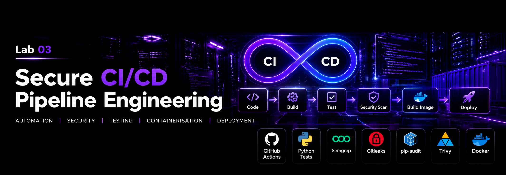

GitHub DevSecOps Lab 03 — Secure CI/CD Pipeline Engineering with GitHub Actions

""CI Pipeline" (https://github.com/SkynetAI-Labs/lab-03-secure-cicd-pipeline/actions/workflows/ci.yml/badge.svg?branch=main)" (https://github.com/SkynetAI-Labs/lab-03-secure-cicd-pipeline/actions/workflows/ci.yml)

A hands-on DevSecOps project by SkynetAI-Labs, demonstrating automated testing, security scanning, protected pull requests, and controlled container delivery.

Project objective

Build a pipeline that checks application code and container dependencies before publishing a container image. Demonstrate both a blocked security check and successful recovery.

The application is deliberately small: a Python function returns a health status. The focus is pipeline engineering rather than application complexity.

Pipeline architecture

flowchart TD
    A[Push or pull request] --> B[Python unit tests]
    A --> C[Bandit code security scan]
    A --> D[Build and run container]
    D --> E[Trivy vulnerability scan]
    E --> F[On main: save scanned image]
    B --> G[Delivery gate]
    C --> G
    F --> G
    G --> H[On main push only: publish same image to GHCR]

Pull requests run the tests and security scans without publishing. On pushes to main, delivery waits for all three check jobs to succeed.

Tools and technologies

- GitHub Actions for CI and delivery.
- Python 3.12 and unittest for the application and tests.
- Bandit for Python security analysis.
- Docker with an Alpine-based Python image.
- Trivy for container vulnerability scanning.
- GitHub Container Registry (GHCR) for image delivery.
- Ubuntu/WSL for local development.

Security controls

Control| Implementation
Protected main branch| Pull requests and passing unit, code security, and container checks required
Administrator enforcement| Branch protection configured to prevent bypassing
Action version integrity| Direct workflow action references pinned to full commit SHAs
Limited permissions| Read-only repository access by default; package write access limited to delivery
Checkout credentials| Credential persistence disabled
Container execution| Application runs as an unprivileged user
Vulnerability policy| Trivy fails on HIGH or CRITICAL findings, including unfixed findings
Delivery gate| Publishing depends on successful tests, Bandit, and container scanning
Image continuity| Delivery loads and publishes the scanned image without rebuilding
Image identification| Published images tagged with the Git commit SHA
Authentication| GitHub supplies the workflow credential; no manually managed registry token
Artifact retention| Scanned image transfer artifact retained for one day

Validation evidence

Unsafe code detection and recovery

An isolated demonstration branch introduced an unsafe eval() call without executing it. Bandit reported B307 with medium severity and high confidence, and the security job failed.

- "Expected security failure" (https://github.com/SkynetAI-Labs/lab-03-secure-cicd-pipeline/actions/runs/39068127558)
- "Successful run after removing the unsafe example" (https://github.com/SkynetAI-Labs/lab-03-secure-cicd-pipeline/actions/runs/39068386964)

The unsafe example was removed from the demonstration branch and was not merged into main.

Container vulnerability remediation

The initial Debian-based image scan reported 44 HIGH findings. The container base was changed to Python Alpine, available Alpine package updates were applied, and the existing scan policy was retained. The revised image passed the checks.

- "Container build and remediation pull request" (https://github.com/SkynetAI-Labs/lab-03-secure-cicd-pipeline/pull/2)

Controlled delivery

The main-branch workflow successfully ran unit tests, Bandit, and Trivy, then published the scanned image to GHCR.

- "Successful delivery run" (https://github.com/SkynetAI-Labs/lab-03-secure-cicd-pipeline/actions/runs/39071760350)
- "Delivery implementation" (https://github.com/SkynetAI-Labs/lab-03-secure-cicd-pipeline/pull/3)
- "Action and runner maintenance" (https://github.com/SkynetAI-Labs/lab-03-secure-cicd-pipeline/pull/4)

Run the tests locally

From the repository root:

python3 -m unittest discover -s tests -v

Build and run locally

These commands require access to a running Docker engine:

docker build --pull -t secure-cicd-demo:local .
docker run --rm secure-cicd-demo:local

The container prints its health status and exits; it does not run a web server.

Published image

ghcr.io/skynetai-labs/secure-cicd-pipeline-github-actions:<full-commit-sha>

Replace the tag with the full main-branch commit SHA from a successful delivery run. Registry access depends on the package's visibility and permissions.

Repository structure

.github/workflows/ci.yml  Tests, security scans, and gated delivery
app/health.py            Demonstration application
tests/test_health.py     Unit test
Dockerfile               Non-root Python container
.dockerignore            Container build exclusions
.gitignore               Local file exclusions
README.md                Project documentation

Scope and limitations

This lab demonstrates continuous integration and container delivery to a registry. It does not deploy an application to a live environment.

A passing scan means no findings matched the configured failure policy at scan time; it does not guarantee an image is free of vulnerabilities. Lower-severity vulnerabilities do not fail the container job.

Action pins, scanner versions, base images, and vulnerability findings require ongoing maintenance. The base image uses a version tag rather than an immutable image digest.

Skills demonstrated

GitHub Actions workflow design, Python testing, security analysis, container hardening, vulnerability remediation, branch protection, pull request workflows, least-privilege permissions, and gated image delivery.

Part of the SkynetAI-Labs GitHub portfolio.
